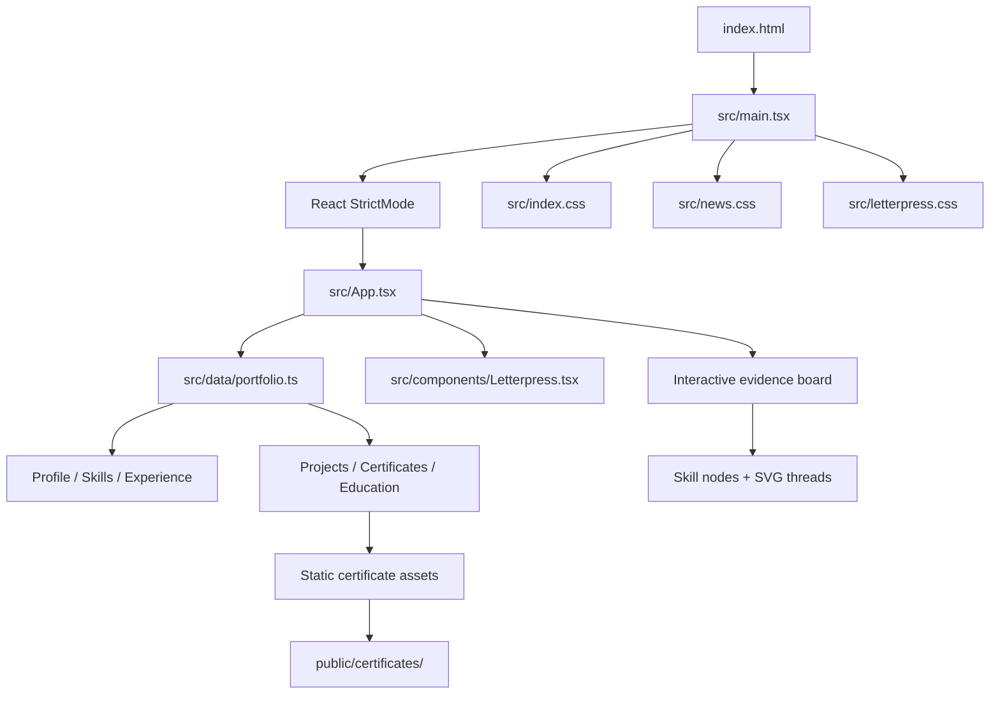
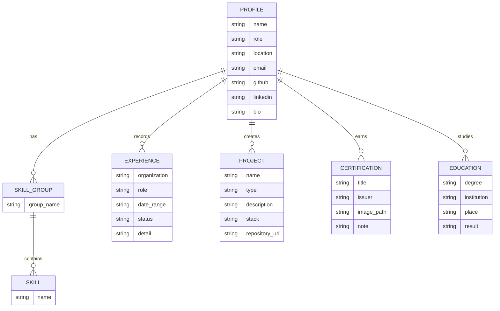

<div align="center">

# THE DEVELOPER'S CHRONICLE
### A PORTFOLIO PRESERVED AS AN INVESTIGATIVE NEWSPAPER

**RANJITH M. · FULL-STACK DEVELOPER · VILLUPURAM, TAMIL NADU**

*Vol. 01 · The Personal Archive · 2026*

---

> **THE FRONT-PAGE STORY**
>
> A living record of skills, projects, experience, education and credentials — arranged as an aged newspaper and an investigator's evidence wall.

[](https://react.dev/)
[](https://www.typescriptlang.org/)
[](https://vite.dev/)
[](#)

</div>

---

## 📰 FRONT-PAGE INDEX

| EDITION | CONTENT |
|---|---|
| 01 | [Project overview](#01--the-story) |
| 02 | [Visual direction](#02--the-editorial-language) |
| 03 | [Motion & transitions](#03--motion-picture) |
| 04 | [Application architecture](#04--inside-the-newsroom) |
| 05 | [Conceptual ER diagram](#05--the-archive-ledger-erd) |
| 06 | [Repository tree](#06--the-file-cabinet) |
| 07 | [Development](#07--run-the-press) |
| 08 | [Content editing](#08--update-the-record) |
| 09 | [Quality & accessibility](#09--quality-control) |
| 10 | [Hosting note](#10--publication-and-hosting) |

---

## 01 · THE STORY

This repository contains a responsive, single-page portfolio for **Ranjith M.** The interface takes inspiration from historical newspapers, investigative case files and archival evidence boards.

Rather than presenting a conventional grid of portfolio cards, the site treats each section as a page in a personal chronicle:

- **Front page** — identity, introduction and editorial masthead.
- **About** — profile and professional direction.
- **Skills evidence board** — draggable skill nodes connected by red investigative threads.
- **Experience** — a chronological professional record.
- **Projects** — project clippings with supporting evidence.
- **Certificate archive** — credential scans presented as pinned documents.
- **Education** — academic history.
- **Contact** — direct contact and social links.

The project is a **static frontend**. It does not currently include an API server, authentication system or persistent database. Portfolio content is maintained in TypeScript.

## 02 · THE EDITORIAL LANGUAGE

### Art direction

| Element | Treatment |
|---|---|
| Paper | Aged ivory, parchment and warm newsprint |
| Primary ink | Charcoal / near-black |
| Accent ink | Oxblood and muted red |
| Supporting tones | Dusty brown, pencil grey and aged gold |
| Display typography | Unifraktur, Pirata One and Playfair Display |
| Editorial typography | Goudy Bookletter 1911 and Special Elite |
| Utility typography | IBM Plex Mono and Pathway Gothic One |
| Texture | Fine paper grain, ruled columns and printed-paper surfaces |
| Composition | Mastheads, clippings, pinned documents and evidence-board layouts |

The visual language is deliberately editorial. It avoids generic glassmorphism and keeps the content legible over the paper textures.

### Visual motifs

- **Newspaper masthead:** establishes the publication identity and issue details.
- **Paper clippings:** project information is composed like extracted newspaper articles.
- **Evidence pins:** skill and certificate elements feel attached to a physical archive.
- **Red thread:** SVG connections make relationships between skills visible.
- **Archive marks:** small labels, folio numbers and ruled dividers reinforce the printed-document language.
- **Ink and dust:** texture is used as atmosphere, not as a replacement for readable content.

## 03 · MOTION PICTURE

Motion is part of the editorial storytelling. Different content types use different entrances so the page does not feel like one repeated animation preset.

| Motion treatment | Where it is used | Purpose |
|---|---|---|
| **Letterpress pop** | Selected headlines and titles | Characters rise, sharpen and settle like freshly pressed type |
| **Newspaper drop** | Evidence-board entrance | The board lands with a restrained paper-like movement |
| **Evidence pin** | Skill nodes | Nodes appear with a small drop, scale and settling motion |
| **Red-thread draw** | Skill connections | SVG strokes reveal progressively like string being laid across a case board |
| **Ink reveal** | Editorial content | A clipped horizontal reveal resembles text emerging from ink |
| **Headline press** | Large editorial headings | A soft rise and focus transition gives headlines their own entrance |
| **Column entrance** | Section headings and content columns | Editorial columns enter with a short vertical movement |
| **Folio entrance** | Small publication metadata | Issue labels and folio details settle into place |
| **Scroll reveal** | Sections marked with `.reveal` | Content enters when it reaches the viewport |

### Letterpress sequence

The `Letterpress` component splits selected text into visual characters, staggers their entrance and retains a single accessible label for assistive technology.

```tsx
<Letterpress text="Ranjith" />
<Letterpress text="M." delay={430} />
```

### Skill-board interaction lifecycle

1. A pointer press captures the selected skill node.
2. Pointer movement is coalesced with `requestAnimationFrame`.
3. The dragged node, nearby nodes and SVG thread geometry are updated together.
4. On release, the evidence cluster remains displaced for **3 seconds**.
5. The nodes return to their responsive default positions and the selected/dimmed state is cleared.
6. Pointer cancellation restores the default layout immediately.

The drag path avoids a full React render for every pointer event. React state is committed when the interaction finishes.

### Motion accessibility

The letterpress animation explicitly respects `prefers-reduced-motion`. The global reveal system and other CSS animations should be reviewed against the same preference whenever new motion is introduced.

## 04 · INSIDE THE NEWSROOM

### Runtime architecture

The application is intentionally small: a Vite entry point mounts a React application; the page reads structured content from a TypeScript data module; CSS files define the visual system and animation language.



### Responsibility map

| Module | Responsibility |
|---|---|
| `src/main.tsx` | React root, Strict Mode and stylesheet imports |
| `src/App.tsx` | Page composition, section interactions, certificate modal and skill board |
| `src/data/portfolio.ts` | Profile, skills, experience, project, certificate and education records |
| `src/components/Letterpress.tsx` | Reusable staggered character reveal |
| `src/index.css` | Global foundations, typography and base layout |
| `src/news.css` | Newspaper art direction, evidence board, clippings and editorial motion |
| `src/letterpress.css` | Letterpress character animation and reduced-motion fallback |
| `public/certificates/` | Certificate image assets |

## 05 · THE ARCHIVE LEDGER (ERD)

> **Important:** This is a conceptual content-model diagram, not a deployed database schema. The current implementation stores these records as JavaScript/TypeScript objects and arrays in `src/data/portfolio.ts`. No SQL database or ORM is configured in this repository.



### Data ownership

- One profile is the root record for the portfolio.
- A profile contains multiple skill groups; each group contains multiple skills.
- Experience, projects, certifications and education are independent collections associated with the profile.
- Certificate image paths point to static files under `public/certificates/`.
- Project repository URLs are optional. Missing URLs should remain unset until verified; do not invent destinations.

## 06 · THE FILE CABINET

Repository layout at the time of this documentation:

```text
Ranjith-portfolio/
├── public/
│   ├── certificates/
│   │   ├── codsoft-java.jpg
│   │   ├── dexathon.jpg
│   │   ├── digital-fundamentals.jpg
│   │   ├── frontend-naan-mudhalvan.jpg
│   │   ├── google-cloud-genai.jpg
│   │   ├── kaggle-python.jpg
│   │   ├── prompt-engineering.jpg
│   │   ├── salesforce.jpg
│   │   ├── step-english.jpg
│   │   ├── vglug-genai.jpg
│   │   └── vikieme-python.jpg
│   ├── favicon.svg
│   └── profile.png
├── src/
│   ├── components/
│   │   └── Letterpress.tsx
│   ├── data/
│   │   └── portfolio.ts
│   ├── App.tsx
│   ├── index.css
│   ├── letterpress.css
│   ├── main.tsx
│   └── news.css
├── .gitignore
├── index.html
├── package-lock.json
├── package.json
├── tsconfig.json
└── vite.config.ts
```

The repository also contains the supplied `Ranjith info.zip` source archive. It is not required by the runtime build.

## 07 · RUN THE PRESS

### Requirements

- Node.js compatible with the Vite 6 toolchain (Node.js 20+ recommended).
- npm.

### Install and run locally

```bash
git clone https://github.com/numankhan2007/Ranjith-portfolio-.git
cd Ranjith-portfolio-

npm install
npm run dev
```

Vite prints the local development URL in the terminal. The current Vite configuration uses port `3000`.

### Production build

```bash
npm run build
npm run preview
```

Available scripts:

| Command | Description |
|---|---|
| `npm run dev` | Start the Vite development server |
| `npm run build` | Create the production bundle in `dist/` |
| `npm run preview` | Preview the production build locally |

## 08 · UPDATE THE RECORD

Most portfolio content should be edited in one place:

`src/data/portfolio.ts`

### Add a project

Add an object to the `projects` array:

```ts
{
  name: 'Project title',
  type: 'Web application',
  description: 'A concise, evidence-based description.',
  stack: ['React', 'TypeScript'],
  repo: null
}
```

Use a real repository URL only after it has been confirmed.

### Add a certificate

1. Place the image in `public/certificates/`.
2. Add a record to the `certifications` array.
3. Use a root-relative image path, for example `/certificates/example.jpg`.
4. Keep the title and issuer faithful to the certificate.

### Add a skill

Update the relevant skill group in the data module. The interactive evidence board is separately configured in `src/App.tsx`; its node list, default positions and connection pairs must stay in sync when changing the number of displayed nodes.

### Change the visual system

- Global typography and base styles: `src/index.css`
- Newspaper-specific visual language and motion: `src/news.css`
- Letterpress timing and glyph behavior: `src/letterpress.css`
- Character markup and accessible text label: `src/components/Letterpress.tsx`

## 09 · QUALITY CONTROL

Before merging a change:

- [ ] Run `npm install` and confirm dependencies install from the lockfile.
- [ ] Run `npm run build` and resolve TypeScript/Vite errors.
- [ ] Check the page at desktop, tablet and mobile widths.
- [ ] Drag multiple skill nodes; confirm threads follow the nodes.
- [ ] Release a dragged node; confirm the 3-second return and selection reset.
- [ ] Cancel a drag; confirm the board returns to its default state.
- [ ] Open and close certificate details; check keyboard focus and Escape handling.
- [ ] Confirm every certificate image path resolves.
- [ ] Test reduced-motion preferences and keyboard navigation.
- [ ] Check browser console and network requests for errors.

### Known implementation boundaries

- Portfolio data is static; there is no CMS or admin dashboard.
- There is no application database or backend API.
- Contact actions use the visitor's email client.
- Some project repository destinations are intentionally unset pending confirmation.
- External Google Fonts require network access; provide local font fallbacks if offline rendering becomes a requirement.

## 10 · PUBLICATION AND HOSTING

This repository is a standard Vite static frontend. It can be built with `npm run build` and the generated `dist/` directory can be served by any static hosting provider.

**Hosting is not part of the application architecture.** No Vercel-specific runtime dependency is required by the source code. The associated Vercel project has been paused to stop normal production hosting. Its project record, deployment history and aliases still exist until the owner confirms project deletion in the Vercel dashboard.

---

<div align="center">

**END OF EDITION · THE ARCHIVE REMAINS OPEN**

*Filed under: React · TypeScript · Vite · Editorial Interface Design*

</div>
